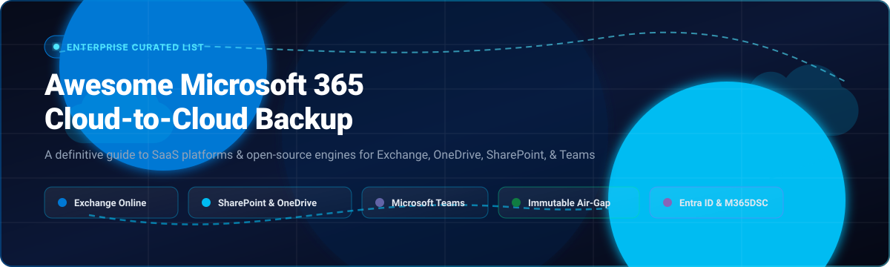

  

# ☁️ Awesome Microsoft 365 Cloud-to-Cloud Backup 🛡️

> 🌟 A curated list of top **Microsoft 365 Cloud-to-Cloud Backup** solutions, enterprise SaaS platforms, and open-source data protection engines for Exchange Online, SharePoint Online, OneDrive for Business, Microsoft Teams, and Entra ID (Azure AD). 🚀

---

## 📋 Table of Contents

- [📈 Sector Overview & Market Dynamics](#-sector-overview--market-dynamics)
- [🟦 Enterprise SaaS & Hosted Platforms](#-enterprise-saas--hosted-platforms)
- [🟩 Open-Source Solutions](#-open-source-solutions)
- [📊 Feature Comparison Matrix](#-feature-comparison-matrix)
- [🔍 Selection & Architecture Guide](#-selection--architecture-guide)
- [💖 Support & Sponsorship](#-support--sponsorship)
- [🤝 Contributing](#-contributing)
- [⭐ Star History](#-star-history)
- [📄 License](#-license)

---

## 📈 Sector Overview & Market Dynamics

The dedicated **Microsoft 365 backup and SaaS data protection market** 💼 is valued at approximately **$3.2 billion** 💰 and is projected to expand toward **$10 billion** over the next decade at a ~13.8% CAGR 📊 (with the broader cloud-to-cloud data protection sector scaling past $20+ billion 🌐). 

The sector exhibits **moderate-to-high fragmentation** 🧩: while market heavyweights such as Veeam, Commvault, and Rubrik capture major enterprise market share, Microsoft's native "Shared Responsibility Model" ⚖️ leaves an ongoing protection gap that fosters intense competition among dozens of specialized SaaS ISVs 🚀, cloud-native startups ☁️, and MSP-tailored backup wrappers rather than a single winner-take-all monopoly 🏆.

---

## 🟦 Enterprise SaaS & Hosted Platforms

Commercial, fully hosted Microsoft 365 cloud-to-cloud backup platforms providing automated snapshots 📸, compliance archiving 🏛️, air-gapped vaults 🔒, and ransomware recovery 🛡️.

> 💡 **Microsoft 365 Shared Responsibility Reminder:** Standard Microsoft 365 E3/E5 licenses provide high infrastructure availability and short-term recycle bin retention (30–90 days) ⏱️, but **do not include comprehensive long-term backup or point-in-time rollback** ⚠️. Microsoft's native pay-as-you-go backup add-on is priced at **$0.15/GB/month** of protected content 💳.

*Sorted descending by company size (Valuation / Market Capitalization / Annual Revenue).* 🏢

| Platform 🏷️ | Valuation / Company Size 💼 | Pricing (Specific Starting Tiers) 💵 | Free Tier / Free Trial Limits 🎁 | Key Workloads Supported 📦 | Air-Gapped / Immutability 🔒 |
| :--- | :--- | :--- | :--- | :--- | :--- |
| **[Rubrik](https://www.rubrik.com)** *(via Sophos / Security Cloud)* | **~$18B–$20B Market Cap** 📈 (Public: NYSE: RBRK, ~$1.3B ARR) | Starts at **$4.00 / user / month** ($48.00 / user / year list MSRP via Sophos Central, 200-seat baseline; Rubrik enterprise USL tiers scale per-seat) 🏷️ | **30-day full-feature trial** (capped up to 500 protected users; custom enterprise sandbox) ⏳ | Exchange Online, OneDrive, SharePoint, Teams 📨 | ✅ Air-gapped, WORM-locked immutable cloud 🧊 |
| **[Veeam](https://www.veeam.com)** *(Veeam Data Cloud / Backup for M365)* | **$15B Valuation** 🦄 (Private, backed by Insight Partners/TPG, >$2B ARR) | Starts at **$2.63 / user / month** (Veeam Data Cloud Foundation SaaS tier with unlimited Azure storage; on-prem software subscriptions from ~$1.80/user/month) 💳 | **Forever-Free Community Edition** up to **10 users, 10 teams, and 1 TB SharePoint/OneDrive** (self-hosted); **30-day free trial** for Veeam Data Cloud SaaS 🎁 | Exchange Online, SharePoint Online, OneDrive, Teams 📁 | ✅ S3/Azure Object Lock & hardened Linux immutability 🛡️ |
| **[Commvault Cloud](https://www.commvault.com)** *(formerly Metallic)* | **~$5.5B–$6.0B Market Cap** 🏢 (Public: NASDAQ: CVLT, ~$1B Revenue) | Starts at **$1.70 / user / month** (Commvault Cloud for M365 Core Essentials tier; ~$3.50–$4.50/user/mo for Advanced Threat Scan & Governance) 💲 | **30-day free trial** with full platform access (unlimited backup jobs and threat scanning during trial period) ⏱️ | Exchange, OneDrive, SharePoint, Teams, Project 📂 | ✅ Air Cove air-gapped immutable cloud storage 🔐 |
| **[AvePoint](https://www.avepoint.com)** *(Cloud Backup for M365)* | **~$3.2B Market Cap** 📊 (Public: NASDAQ: AVPT, ~$420M Revenue) | Starts at **$1.15 / user / month** (£0.85/user/month via G-Cloud / ~€1.10–$2.50/user/mo standard tier with multi-geo Azure storage) 🏷️ | **30-day free trial** with full M365 suite coverage and unlimited backup runs 🚀 | Exchange, SharePoint, OneDrive, Teams, Groups, Planner, Viva 👥 | ✅ Multi-cloud immutable storage (AvePoint Azure or BYOS) 🗄️ |
| **[Druva](https://www.druva.com)** *(Druva Data Security Cloud)* | **$2.0B Valuation** 🦄 (Private, Series H, >$200M ARR) | Starts at **$8.00 / user / month** (Druva M365 Enterprise tier; Elite tier at $10.00/user/mo with federated search and compliance monitoring) 💳 | **30-day free trial** (up to 100 users, 1 TB Druva Cloud Storage, unrestricted granular recovery) 🔍 | Exchange, OneDrive, SharePoint, Teams, Public Folders 📬 | ✅ 100% agentless AWS-hosted air-gapped storage ☁️ |
| **[Keepit](https://www.keepit.com)** *(Keepit for Microsoft 365)* | **~$450M Valuation** 🇩🇰 (Private, ~$45M+ Revenue, scaling to $100M ARR) | Starts at **$1.95 / user / month** (Business Essential tier for volume seats; ~$3.50–$4.25/user/month standard low-volume seat tier) 💵 | **30-day free trial** (unlimited users, full access to independent Keepit private cloud, no credit card required) ✨ | Exchange, Teams, OneDrive, SharePoint, Entra ID / Groups 🔐 | ✅ Vendor-neutral independent private cloud (outside Microsoft Azure) 🏰 |

---

## 🟩 Open-Source Solutions

Self-hosted, developer-friendly, and open-source tools for backing up Microsoft 365 tenants, mailboxes, user drives, and infrastructure configurations. 🛠️💻

*Sorted descending by GitHub stargazers count.* ⭐

| Project 📦 | GitHub_Stars ⭐ | License 📜 | Primary Tech Stack ⚙️ | Description 📝 |
| :--- | :--- | :--- | :--- | :--- |
| **[Microsoft365DSC](https://github.com/Microsoft365DSC/Microsoft365DSC)** |  | MIT 📄 | PowerShell / Desired State Configuration ⚡ | Definitive open-source engine to extract, snapshot, monitor, and restore Microsoft 365 tenant configurations (Entra ID, Intune, Exchange, SharePoint, and Teams policies) as declarative code. 🏛️ |
| **[Corso](https://github.com/alcionai/corso)** |  | Apache-2.0 📄 | Go / Microsoft Graph API / Kopia 🐹 | High-performance, secure, and developer-friendly data protection engine engineered specifically for M365 (Exchange, OneDrive, SharePoint, and Teams) backing up to S3-compatible storage with end-to-end encryption and deduplication. 🚀 |
| **[Atlas](https://github.com/wisecom-oy/atlas)** |  | Apache-2.0 📄 | Python / MS Graph / S3 API 🐍 | Modern open-source backup and recovery engine for Outlook mailboxes, OneDrive files, and SharePoint document libraries into self-managed S3 storage with envelope encryption, incremental delta sync, and S3 Object Lock immutability. 🗃️ |
| **[BackupZit](https://github.com/Max-Zit/backupzit)** |  | AGPL-3.0 📄 | Linux / C# / Graph API 🐧 | Self-hosted enterprise backup console covering Microsoft 365 alongside VMs, physical servers, and databases with read-only Graph integration, deduplication, and direct NAS/S3 targets with zero per-user licensing costs. 💾 |
| **[mailvault](https://github.com/sniner/mailvault)** |  | GPL-3.0 📄 | Python / MS Graph / SQLite 🔍 | Incremental email backup, archiving, and verification utility for Exchange Online mailboxes via Microsoft Graph with SQLite full-text search database, zstd compression, and automated repair. ✉️ |
| **[M365-backup](https://github.com/txdadlab/M365-backup)** |  | Community / Open 📄 | PowerShell / M365DSC 🔧 | Automation wrapper that uses Microsoft365DSC to schedule, capture, and track disaster-recovery backups of entire M365 tenant configurations, security baselines, and Conditional Access rules into Git repositories. 📋 |

---

## 📊 Feature Comparison Matrix

| Solution 🛠️ | Model 🏢 | Exchange Online ✉️ | SharePoint & OneDrive 📁 | Microsoft Teams 💬 | Entra ID / Config 🔑 | Target Storage 🗄️ | Best Suited For 🎯 |
| :--- | :--- | :---: | :---: | :---: | :---: | :--- | :--- |
| **Rubrik (Sophos)** | Commercial SaaS ☁️ | ✅ | ✅ | ✅ | ⚠️ Basic | Sophos Cloud / Azure | Sophos Central customers needing unified endpoint + SaaS backup 🛡️ |
| **Veeam** | Commercial SaaS / Hybrid 🔄 | ✅ | ✅ | ✅ | ✅ | Veeam Azure / BYOS / On-Prem | Free tier for SMBs (<10 seats); enterprise hybrid flexibility 🏢 |
| **Commvault Cloud** | Commercial SaaS ☁️ | ✅ | ✅ | ✅ | ✅ | Air Cove Immutable Cloud | Zero-trust cyber resilience, threat scanning & compliance 🔒 |
| **AvePoint** | Commercial SaaS ☁️ | ✅ | ✅ | ✅ | ✅ | AvePoint Azure / Custom BYOS | Complex SharePoint environments & multi-SaaS governance 🌐 |
| **Druva** | Commercial SaaS ☁️ | ✅ | ✅ | ✅ | ⚠️ Basic | Druva Cloud (AWS Air-gap) | Hands-off, 100% cloud-native SaaS with zero infrastructure 🚀 |
| **Keepit** | Commercial SaaS ☁️ | ✅ | ✅ | ✅ | ✅ | Independent Keepit Cloud | Organizations demanding true non-Azure, vendor-neutral isolation 🏰 |
| **Microsoft365DSC** | Open Source 💻 | ❌ (Config only) | ❌ (Config only) | ❌ (Config only) | ✅ Full | Git / Local Disk | Infrastructure-as-code M365 disaster recovery & drift tracking 📜 |
| **Corso** | Open Source 💻 | ✅ | ✅ | ✅ | ❌ | S3 / MinIO / Ceph | Cloud-native engineering teams wanting secure, S3-backed M365 protection ⚡ |
| **Atlas** | Open Source 💻 | ✅ | ✅ | ❌ | ❌ | AWS S3 / Wasabi / MinIO | Automated Python/S3 backup pipelines with Object Lock immutability 🐍 |
| **BackupZit** | Open Source 💻 | ✅ | ✅ | ⚠️ In Progress | ❌ | NAS / SAN / S3 / Local Disk | Cost-conscious IT homelabs and internal teams managing self-hosted disks 💽 |
| **mailvault** | Open Source 💻 | ✅ (Email only) | ❌ | ❌ | ❌ | Local SQLite / Zstd | Lean, verifiable Exchange Online mailbox archiving and eDiscovery 📬 |
| **M365-backup** | Open Source 💻 | ❌ (Config only) | ❌ (Config only) | ❌ (Config only) | ✅ Full | Git / File Share | Scheduled tenant configuration snapshots for compliance audits 📑 |

---

## 🔍 Selection & Architecture Guide

When evaluating Microsoft 365 Cloud-to-Cloud backup systems, consider these foundational architectural criteria: 📐

1. **Storage Independence (The "Out-of-Band" Principle):** 🏰
   If an adversary compromises your global Entra ID / Azure tenant credentials, backups stored inside the same Azure tenant hierarchy may be wiped. Solutions like **Keepit** (independent custom datacenters), **Druva** (AWS isolated infrastructure), and **Corso / Atlas** (self-hosted offsite S3 with Object Lock) ensure air-gapped protection. 🛡️

2. **Ransomware & Immutability:** 🔒
   Look for WORM (Write Once, Read Many) compliance and API-level immutability. Commercial vendors enforce storage-level air gaps, while open-source tools achieve this through S3 Object Lock in compliance mode. 🧊

3. **Restoration Granularity & Speed:** ⚡
   Verify whether the system allows point-in-time cross-user restore (e.g., restoring an ex-employee's OneDrive files directly into a manager's drive), bulk mailbox hydration, or in-place item rollback without overwriting existing files. ⏱️

4. **API Throttling & Graph Concurrency:** 🚦
   Microsoft Graph enforces strict request thresholds. Enterprise backup tools utilize specialized Graph API endpoints (such as the Microsoft 365 Backup Storage API) or multi-app ID rotation to avoid throttling during massive initial ingestion or complete tenant restorations. 📈

---

## 💖 Support & Sponsorship

If you find this curated guide valuable for safeguarding your organization's Microsoft 365 data, please consider supporting the project! 🌟

- ⭐ **Star this repository** to help others discover it on GitHub.
- 🍴 **Fork and share** it with your fellow IT admins, DevOps engineers, and cloud architects.
- ☕ **Buy a coffee / Sponsor the project:** Support ongoing maintenance and curation on the [GitHub Sponsor Dashboard](https://github.com/sponsors/ishandutta2007).

Your support is deeply appreciated! ❤️🙏

---

## 🤝 Contributing

Contributions, additions, and updates are welcome! 🎉 To contribute:

1. 🍴 Fork this repository.
2. 📝 Add your tool to the corresponding section following the existing table schema.
3. 🏷️ For open-source tools, include the GitHub Stars_Badge linking to the `/stargazers` URL and verify active maintenance (commits within the last 12 months).
4. 💵 For SaaS tools, provide verifiable pricing starting points and free tier/trial limits.
5. 🚀 Submit a pull request with a descriptive title.

---

##  Star History

---

## 📄 License

This repository is licensed under the [Creative Commons Zero v1.0 Universal](LICENSE) (CC0 1.0 - Public Domain Dedication). ⚖️
Individual listed tools and trademarks belong to their respective copyright holders.
